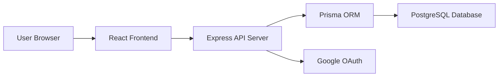
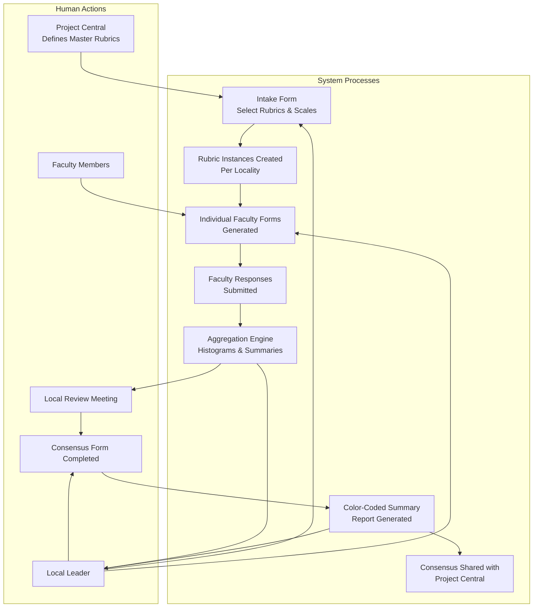
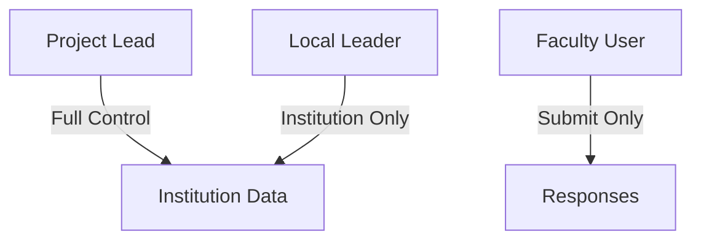
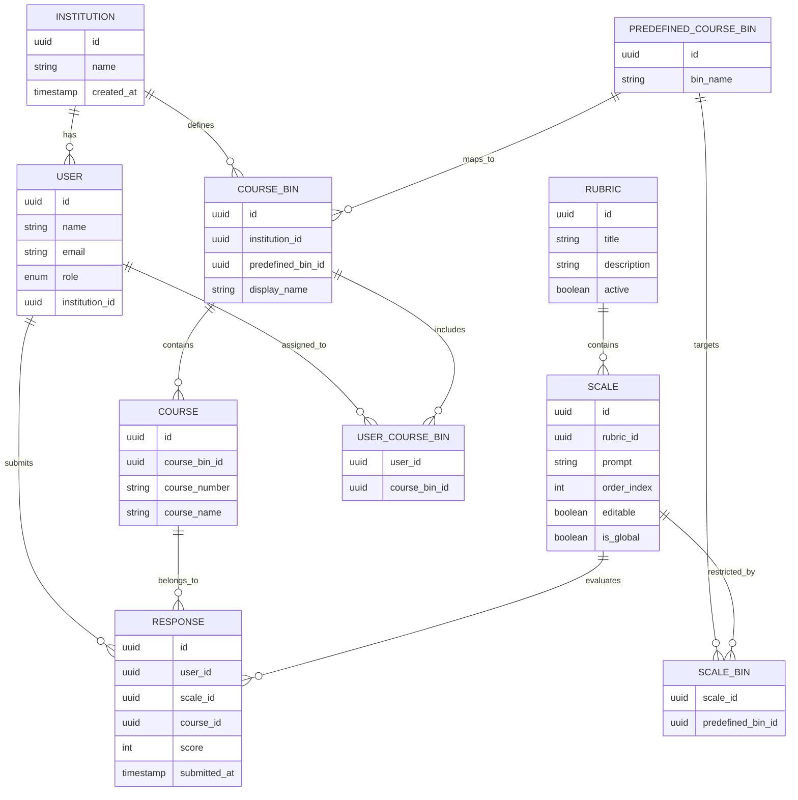
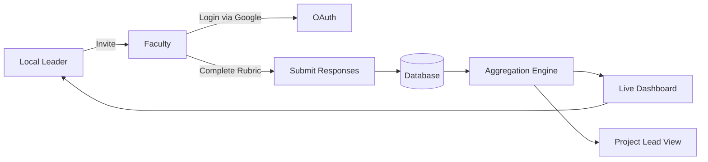
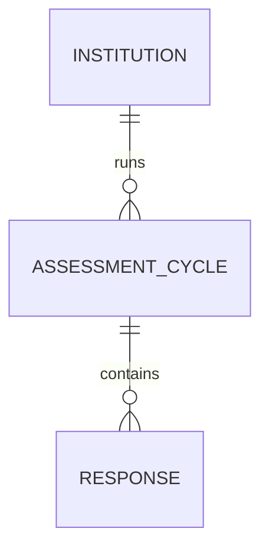
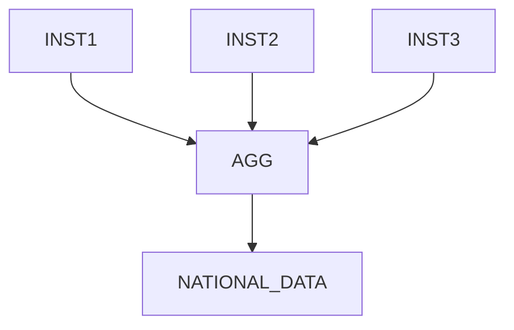
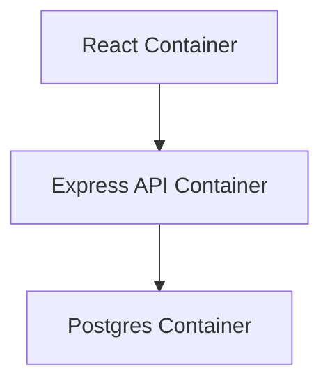

# Undergraduate Math Self-Assessment Portal

### Technical Specification (Draft v0.1)
### Prepared by: Parker Homann
### Target MVP: Early April
### Stabilization: Mid-April
### Deployment: May Institutions

# 1. Purpose and Strategic Intent

This system is a web-based assessment platform designed to support teaching-focused faculty in evaluating and improving undergraduate mathematics instruction at the departmental level.

It is not a survey distribution tool. It is a structured, multi-tenant assessment platform that:

 - Enables faculty to complete standardized rubrics

 - Aggregates results at the course-bin and institutional level

 - Preserves individual anonymity

 - Supports consensus discussions

 - Provides exportable structured data for national pattern analysis

Primary objective of MVP:
Deliver a stable, role-based web portal capable of managing institutions, rubrics, users, and aggregated reporting.

# 2. High-Level Architecture
Technology Stack

|Layer|	Technology|	Rationale|
| ----- | ----- | ----- |
|Frontend|	React (TypeScript)|	Maintainable, modular, scalable UI|
|Backend|	Node.js + Express|	Lightweight, flexible REST API|
|Database|	PostgreSQL|	Structured relational data, strong aggregation|
|Authentication|	Google OAuth 2.0|	Institutional login, no password management|
|Hosting|	University server (containerized)|	Institutional control, no recurring cloud cost|
|Containerization|	Docker|	Portability and future migration|
|Version Control|	GitHub|	Collaboration, CI/CD support|

System Architecture Diagram

# 3. Multi-Tenant Design

The system is designed as a multi-institution platform.

 - Each institution:

 - Has its own users

 - Has its own course bins and course mappings

 - Has access only to its own aggregated data

Project Leads:

 - Can view all institutions

 - Can modify global rubrics

 - Can export cross-institution data

# 4. User Roles & Permissions
Role Definitions
1. Project Lead (Global Admin)

   * Create/edit institutions

   * Create/edit global rubrics and scales

   * View all institutional aggregate data

   * Export national datasets

   * Manage local leaders

2. Local Leader (Institution Admin)

   * Invite faculty users

   * Assign users to course bins

   * View aggregated institutional results

   * Export institutional CSV/Excel

   * Manage course mappings

3. Faculty User

   * Log in via Google OAuth

   * View assigned rubrics

   * Submit responses per course

   * Edit responses before final submission

Role-Based Access Control Model

Authorization enforced at:

 - API middleware level

 - Database query filtering layer

# 5. Core Data Model
Entity Relationship Diagram

# 6. Rubric Structure

 - ~7 primary rubrics

 - Each rubric contains multiple “scales”
    - Scale is akin to question / query

 - Each scale scored 0–4
    - Likert

 - Project Leads can:

    - Add new scales

    - Edit scale wording

    - Deactivate scales (preserve historical data)

Scales remain versioned to preserve longitudinal consistency.

# 7. Course Binning Strategy

Each institution:

 - Maps local courses into predefined backend categories

 - Backend categories remain standardized for national aggregation

Example:

|Local Course|	Backend Bin|
| ----- | ----- |
|MATH 101|	College Algebra|
|Survey of Math|	Quantitative Reasoning|

Aggregation always occurs at:

 - Course bin level

 - Institutional level

 - Cross-institution level (Project Leads only)

# 8. Data Flow

# 9. Reporting & Visualization

MVP Reporting:

 - Histogram per scale

 - Average score per course bin

 - Average score per rubric

 - Export CSV

 - Export Excel

Future expansion:

 - Longitudinal comparison
    - Longitudinal comparison allows an institution to run the assessment multiple times (e.g., annually) and compare results across time.

    - Instead of seeing a single snapshot, departments would see:

    - Year-over-year score changes

    - Trend direction (improving, declining, stagnant)

    - Impact of reforms after implementation

    - Example:
       - If “Course Coordination” averaged 2.1 in 2026 and 3.0 in 2027, that change becomes visible and measurable.
    

 - National benchmarking
    - National benchmarking allows institutions to compare themselves against anonymized national averages across participating schools.

    - Example:

       - Your institution’s “Quantitative Reasoning” bin averages 2.4.

       - National average is 2.9.

       - Peer teaching-focused institutions average 3.1.

# 10. Privacy & Compliance

 - No student data

 - No FERPA implications

 - Standard faculty PII (name, email)

 - Google OAuth eliminates password storage

 - Individual responses not exposed to peers

 - Only aggregated data visible

Optional future:

 - Audit logging (who modified rubric, when)

# 11. Admin Dashboard Capabilities

Project Lead Dashboard:

 - Institution management

 - Rubric editor (no-code)

 - Scale ordering

 - Activate/deactivate scales

 - Export national data

Local Leader Dashboard:

 - Course bin editor

 - User invitation

 - Aggregated visualization

 - Export institutional data

# 12. Deployment & DevOps
Repository Structure
 - /frontend
 - /backend
 - /docker
 - /docker-compose.yml

Docker Strategy

 - Separate frontend + backend containers

 - PostgreSQL container

 - Single docker-compose for MVP

Ready for migration to:

 - University VM

 - AWS

 - Azure

 - GCP

Container Diagram

# 13. MVP Feature Scope

 - Google OAuth login

 - Role-based routing

 - Institution isolation

 - Rubric rendering

 - Scale scoring 0–4

 - Course-based submission

 - Aggregated dashboard

 - CSV export

 - Admin rubric editor

# 14. Definition of Success (April)

By early April:

 - Users can log in

 - Local leaders can invite faculty

 - Faculty can complete rubrics

 - Aggregated data visible live

 - Export works

 - Deployed in Docker container on test server

By mid-April:

 - Bug fixes complete

 - UI stabilized

 - Ready for May institutional rollout

# 15. Maintainability Strategy

 - Modular React components

 - Clear separation of concerns

 - Clean REST API structure

 - Environment-based configuration

 - Documented database schema

 - Minimal external dependencies

 - No Google Sheets or fragile document APIs

The system is designed so that another developer could assume maintenance without specialized knowledge.